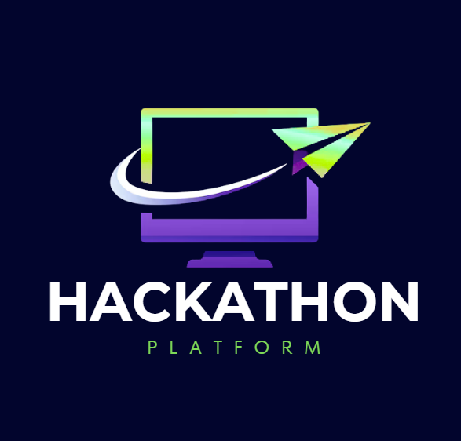
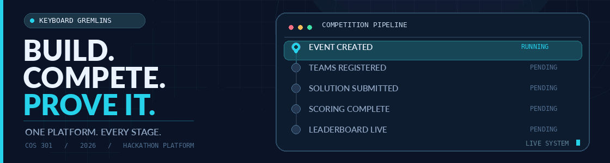
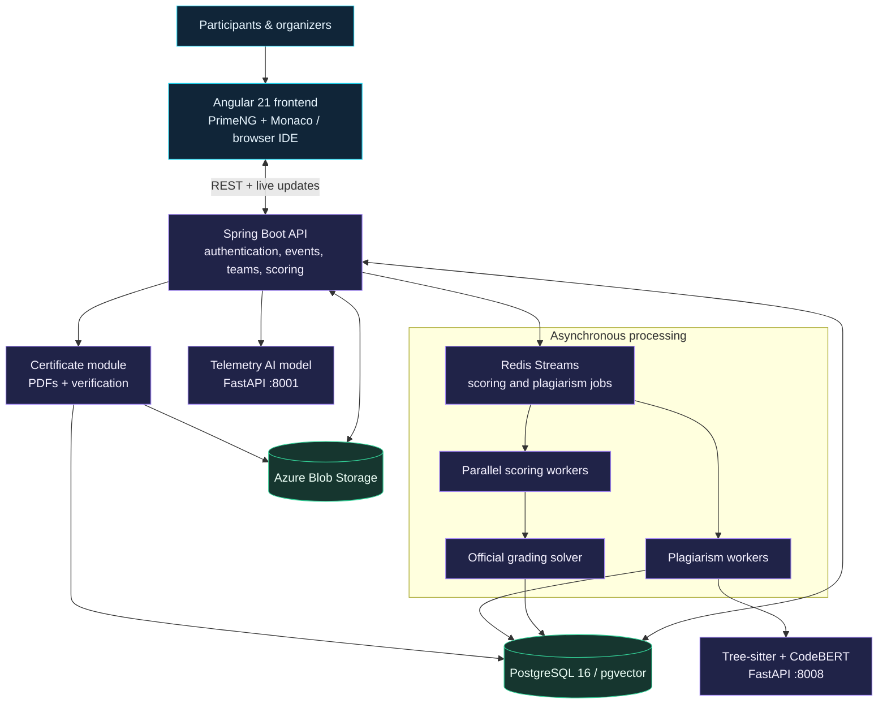
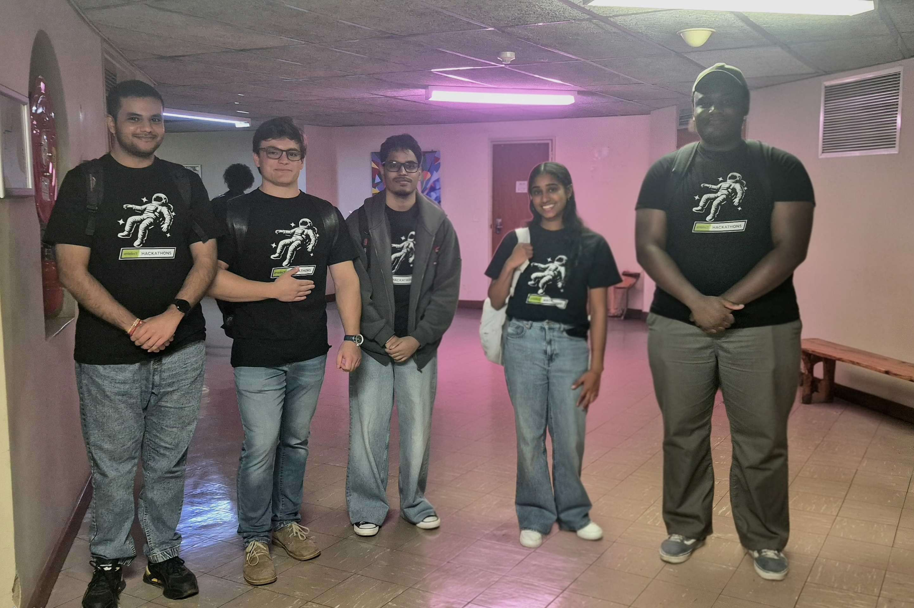

<!--
  Keyboard Gremlins | COS 301 | University of Pretoria | 2026
  GitHub-compatible README: native Markdown, clickable Shields badges, Mermaid and a GIF.
  The GIF is stored in docs/readme-hero.gif. No JavaScript or unsupported CSS is required.
-->

<p align="center">
  <a href="https://hackathonplatform.co.za" title="Open the Hackathon Platform">
    
  </a>
</p>

<p align="center">
  
</p>

<h1 align="center">Hackathon Platform</h1>
<p align="center">
  <strong>Run the hackathon. Not the spreadsheets.</strong><br />
  A full-stack competition platform for creating events, writing code, scoring solutions,<br />
  investigating integrity signals and celebrating participants.
</p>

<p align="center">
  <a href="https://hackathonplatform.co.za"></a>
  <a href="https://api.hackathonplatform.co.za/swagger-ui/index.html"></a>
  <a href="https://github.com/orgs/COS301-SE-2026/projects/54"></a>
</p>

<!-- Live metrics: a deliberately small, consistently styled status row. -->
<p align="center">
  <a href="https://github.com/COS301-SE-2026/Hackathon-Platform/actions/workflows/ci.yml"></a>
  <a href="https://github.com/COS301-SE-2026/Hackathon-Platform/actions/workflows/cd.yml"></a>
  <a href="https://github.com/COS301-SE-2026/Hackathon-Platform/actions/workflows/lighthouse.yml"></a>
  <a href="https://codecov.io/gh/COS301-SE-2026/Hackathon-Platform"></a>
  <a href="https://hackathonplatform.co.za"></a>
</p>

<p align="center">
  
  
  
  
  
  
  
  
</p>

<p align="center">
  <a href="#signature-features">Signature Features</a> &nbsp;•&nbsp;
  <a href="#core-platform-features">Core Features</a> &nbsp;•&nbsp;
  <a href="#competition-lifecycle">How It Works</a> &nbsp;•&nbsp;
  <a href="#architecture">Architecture</a> &nbsp;•&nbsp;
  <a href="#getting-started">Get Started</a> &nbsp;•&nbsp;
  <a href="#documentation">Docs</a>
</p>

---

## Overview

**Hackathon Platform** is built by **Keyboard Gremlins** to manage deterministic optimization competitions end to end. Organizers configure events and official grading solvers; teams develop and submit solutions; a Redis-backed pool of concurrent workers scores those submissions; and results reach live leaderboards.

The platform goes beyond hosting and judging: it includes **two distinct integrity-review systems** and **personalized, verifiable certificates**, bringing competition operations and post-event workflows together.

> [!NOTE]
> **Scoring is deterministic.** The official event solver determines submission scores. The AI-assistance and plagiarism tools produce *review signals* and do not independently establish wrongdoing.

## Signature features

**The capabilities that make the platform stand out.** Three purpose-built workflows beyond ordinary event management.

<table>
  <tr>
    <td width="33%" valign="top">
      <h3 align="center">🧬 Plagiarism Checker</h3>
      <p align="center"><code>Tree-sitter</code> + <code>CodeBERT</code></p>
      <p>Compare cross-team submissions by <strong>code structure and semantic similarity</strong>, then investigate flagged pairs in an administrator review interface.</p>
      <p align="center"><a href="#plagiarism-checker">Explore the checker →</a></p>
    </td>
    <td width="33%" valign="top">
      <h3 align="center">🧠 AI Assistance Checker</h3>
      <p align="center"><code>IDE telemetry</code> + <code>ML</code></p>
      <p>Analyze how code was created — typing, pastes, edits and IDE activity — to flag <strong>potential AI-assisted sessions</strong> for review.</p>
      <p align="center"><a href="#ai-assistance-checker">Explore the detector →</a></p>
    </td>
    <td width="33%" valign="top">
      <h3 align="center">🎓 Certificate Generator</h3>
      <p align="center"><code>Custom PDFs</code> + <code>Verification</code></p>
      <p>Issue <strong>personalized certificates</strong> from reusable templates, generate them in batches, and verify issued awards using unique codes.</p>
      <p align="center"><a href="#certificate-generator">Explore certificates →</a></p>
    </td>
  </tr>
</table>

### Plagiarism checker

Designed for **post-submission code comparison** rather than simplistic string matching. An organizer can initiate a batch check (including top-team scopes); the backend processes comparisons asynchronously and surfaces suspicious submission pairs.

- **Structural analysis:** Tree-sitter normalizes source code into AST-derived tokens; k-gram fingerprints and winnowing support structural similarity comparisons.
- **Semantic analysis:** CodeBERT function embeddings help recognize related solutions even when syntax has been changed.
- **Review workflow:** administrators can inspect similarity scores and side-by-side code comparisons instead of relying on a single binary flag.

When both signals are available, the default combined score uses **60% structural** and **40% embedding** similarity. The analysis uses threshold-based flagging; results still need human interpretation.

**Implementation:** [`PlagiarismCheckService.java`](./backend/src/main/java/com/hackathon/platform/plagiarism/PlagiarismCheckService.java) · [`PlagiarismController.java`](./backend/src/main/java/com/hackathon/platform/controller/PlagiarismController.java) · [`ast-service/`](./ast-service/)

### AI assistance checker

Unlike the plagiarism checker, this model examines **development behavior, not just final source code**. When participants work in the integrated browser IDE, the backend extracts telemetry features for a dedicated FastAPI prediction service.

- **Signals:** typed versus pasted characters, paste ratio, deletions, focus/tab visibility, runs and submission behavior.
- **Inference:** a numeric feature vector is evaluated by a trained model and produces an AI-assistance likelihood and review decision.
- **Separation of concerns:** the Python model service can be maintained independently of the Java business API.

The result indicates **possible AI-assisted activity**, not a definitive answer about authorship.

**Implementation:** [`ML-AI/predict_service.py`](./ML-AI/predict_service.py) · [`ML-AI/`](./ML-AI/)

### Certificate generator

Turn event results and participation into **branded PDF certificates**, without preparing each document manually.

- **Editable designs:** event or hackathon certificate templates can include uploaded backgrounds, custom images and configurable layout elements.
- **Batch generation:** administrators can generate certificates for an event using participant-based or ranking-based recipient scopes, with job status and completion tracking.
- **Verifiable awards:** each issued certificate receives a unique verification code and URL; recipients can download their own PDF certificate.
- **Issued-record management:** the backend retains recipient, event, issuance and certificate metadata for later lookup.

**Implementation:** [`CertificateService.java`](./backend/src/main/java/com/hackathon/platform/service/CertificateService.java) · [`certificate/`](./backend/src/main/java/com/hackathon/platform/certificate/)

> [!IMPORTANT]
> **Integrity-review tools assist organizers; they do not replace human judgment.** Similar solutions can be legitimate, and telemetry alone cannot prove AI use. A review flag should always be considered in context.

## Core platform features

Everything required to **run the competition itself**, organized separately from the three signature capabilities.

| Area | Built-in capability | What organizers and participants get |
|---|---|---|
| 🗓️ **Event setup** | Configurable hackathons | Public/private events, registration, schedules, team limits, rules, technologies, levels and prize settings. |
| 👥 **Teams** | Registration and collaboration | Team creation and joining, membership management and participant administration. |
| 💻 **Coding** | Browser-based IDE | In-browser editing and Java execution using isolated containers, plus the standard submission flow. |
| ⚙️ **Grading** | Automated, parallel scoring | Redis Streams, concurrent scoring workers, event-provided solvers, saved scores and submission logs. |
| 🏆 **Competition** | Live leaderboards | Live rank updates, leaderboard freezes, timers and organizer scoring controls. |
| 📣 **Communication** | Community tools | Announcements and discussion/forum features for hackathon participants. |
| 🛠️ **Operations** | Admin dashboard | Team oversight, participant controls, score management and results export. |
| 🔐 **Identity** | Secure access | Spring Security, role-based permissions, JWT access and Google OAuth integration. |

## Competition lifecycle

From joining an event to publishing results, **grading is asynchronous** so the platform can absorb submission spikes without forcing participants to wait for a synchronous solver run.


---

## Architecture

The application separates the UI, business logic, asynchronous grading, data persistence, certificate workflows and analysis services. The deployment uses **Azure Container Apps**, while the application is built from portable containerized components.



### Technology stack

| Layer | Technology |
|---|---|
| **Frontend** | Angular 21, TypeScript, PrimeNG, Monaco Editor |
| **Backend** | Java 21, Spring Boot 3.2, Spring Security, Maven |
| **Persistence** | PostgreSQL 16, pgvector, Spring Data JPA, Flyway |
| **Async processing** | Redis Streams and parallel Java workers |
| **AI-assistance analysis** | Python 3.12, FastAPI, scikit-learn model bundle |
| **Plagiarism analysis** | Python 3.11, FastAPI, Tree-sitter, CodeBERT / PyTorch |
| **Certificates** | Java, Apache PDFBox, custom templates, verification codes |
| **Infrastructure** | Docker, Docker Compose, Azure Container Apps, Azure Blob Storage |
| **Quality** | JUnit, JaCoCo, Angular tests, Playwright, k6, SonarQube Cloud, Codecov |

### Repository layout

```text
Hackathon-Platform/
|-- backend/                 # Spring Boot APIs, scoring, auth, integrity, certificates
|-- frontend/                # Angular application and integrated editor UI
|-- ML-AI/                   # IDE telemetry AI-assistance prediction service
|-- ast-service/             # Tree-sitter normalization and CodeBERT embeddings
|-- docker/                  # IDE and Java runner container definitions
|-- e2e/                     # Playwright end-to-end scenarios
|-- k6/                      # Performance / load testing
|-- docs/                    # Project documentation and brand assets
|-- .github/workflows/       # CI, CD and quality checks
|-- docker-compose.yml       # Local PostgreSQL, Redis and sidecars
|-- playwright.config.ts     # E2E test configuration
`-- README.md
```

## Getting started

### Prerequisites

- **Java 21** and **Maven**
- **Node.js** compatible with Angular 21 (`20.19+`, `22.12+`, or `24+`) and npm
- **Docker Engine + Docker Compose** for local databases and auxiliary services
- **Git**
- **Python** is needed only if running the AI services outside their Docker images

### 1. Clone the repository

```bash
git clone https://github.com/COS301-SE-2026/Hackathon-Platform.git
cd Hackathon-Platform
```

### 2. Start local infrastructure

The checked-in Compose file starts PostgreSQL **with pgvector** and Redis. The additional analysis services and IDE/runner images are available in the same file.

```bash
# Start the database and job queue
docker compose up -d postgres redis

# Optional: run both integrity-analysis services locally
docker compose up -d --build ai-model ast-service

# Optional: build images used by the browser IDE and local Java runner
docker compose build browser-ide java-runner
```

**Local defaults:** PostgreSQL at `localhost:5432` (database `hackathon_db`, user `hackathon_user`, password `hackathon_password`); Redis at `localhost:6379`; AI prediction service at `localhost:8001`; AST sidecar at `localhost:8008`. The database credentials are **development-only** defaults from `docker-compose.yml`.

> The CodeBERT sidecar downloads/builds a comparatively large CPU-based ML image; the first build can require additional disk space and memory.

### 3. Configure the backend

The backend reads secrets and service locations from environment variables. At minimum, set the PostgreSQL connection and a strong JWT secret. Mail, Google OAuth and Azure Blob Storage also have configuration placeholders; supply valid development credentials for integrations you enable.

<details>
<summary><strong>Example: Bash / macOS / Linux</strong></summary>

```bash
export SPRING_DATASOURCE_URL="jdbc:postgresql://localhost:5432/hackathon_db"
export SPRING_DATASOURCE_USERNAME="hackathon_user"
export SPRING_DATASOURCE_PASSWORD="hackathon_password"
export JWT_SECRET="replace-with-a-long-random-development-secret-at-least-32-bytes"
export REDIS_HOST="localhost"
export REDIS_PORT="6379"
export AI_MODEL_URL="http://localhost:8001"
export AST_SERVICE_BASE_URL="http://localhost:8008"
```

</details>

<details>
<summary><strong>Example: Windows PowerShell</strong></summary>

```powershell
$env:SPRING_DATASOURCE_URL = "jdbc:postgresql://localhost:5432/hackathon_db"
$env:SPRING_DATASOURCE_USERNAME = "hackathon_user"
$env:SPRING_DATASOURCE_PASSWORD = "hackathon_password"
$env:JWT_SECRET = "replace-with-a-long-random-development-secret-at-least-32-bytes"
$env:REDIS_HOST = "localhost"
$env:REDIS_PORT = "6379"
$env:AI_MODEL_URL = "http://localhost:8001"
$env:AST_SERVICE_BASE_URL = "http://localhost:8008"
```

</details>

| Additional setting | Used for |
|---|---|
| `AZURE_STORAGE_CONNECTION_STRING` | Event resources, submission artifacts and scoring logs |
| `MAIL_USERNAME`, `MAIL_PASSWORD` | Account verification / outgoing email |
| `GOOGLE_CLIENT_ID`, `GOOGLE_CLIENT_SECRET` | Google OAuth login |
| `SCORING_CONCURRENCY` | Number of scoring workers (default in config: `10`) |
| `PLAGIARISM_CONCURRENCY` | Number of plagiarism workers (default in config: `2`) |
| `AST_SERVICE_ENABLED`, `AST_EMBEDDING_ENABLED` | Enable AST normalization and semantic embeddings |
| `SUPERADMIN_EMAIL`, `SUPERADMIN_PASSWORD` | Optional bootstrap super-admin configuration |

For the complete configuration, consult [`application.properties`](./backend/src/main/resources/application.properties) and [`application.yml`](./backend/src/main/resources/application.yml). A root `.env.example` exists but is currently empty; **creating a `.env` file alone does not automatically inject variables into Spring Boot**. Provide variables via your shell, IDE launch settings or deployment environment.

### 4. Run the backend

In a terminal where the backend environment variables have been set:

```bash
cd backend
mvn spring-boot:run
```

The local API generally runs on `http://localhost:8080`. If the application starts successfully, API docs are available at `http://localhost:8080/swagger-ui/index.html` and the health endpoint at `http://localhost:8080/actuator/health`.

### 5. Run the frontend

From another terminal at the repository root:

```bash
cd frontend
npm ci
npm start
```

Open **http://localhost:4200**. Full functionality depends on the backend and any configured external integrations being available.

## Testing and code quality

| Scope | Command | Notes |
|---|---|---|
| Backend unit/integration tests | `cd backend && mvn test` | JUnit/Spring tests; JaCoCo report generated |
| Backend verification | `cd backend && mvn clean verify` | Executes the Maven verification lifecycle; JaCoCo minimum line-coverage rule is configured at 60% |
| Backend formatting | `cd backend && mvn spotless:apply` | Applies the project's Java formatting rules |
| Frontend tests | `cd frontend && npm test` | Uses ChromeHeadless with coverage |
| Frontend lint | `cd frontend && npm run lint` | Angular ESLint |
| End-to-end tests | `npm ci && npx playwright install chromium && npm run test:e2e` | Run from repository root, with dependent services running |
| Playwright visual UI | `npm run test:e2e:ui` | Interactive test runner |
| Playwright HTML report | `npm run test:e2e:report` | Opens the latest saved test report |

Performance scenarios live in [`k6/`](./k6/). CI, delivery, Lighthouse, coverage and SonarQube quality checks are configured through GitHub Actions and the repository's quality tooling.

<details>
<summary><strong>View all code-quality and repository metrics</strong></summary>

<p align="center">
  <a href="https://sonarcloud.io/summary/new_code?id=COS301-SE-2026_Hackathon-Platform"></a>
  <a href="https://sonarcloud.io/summary/new_code?id=COS301-SE-2026_Hackathon-Platform"></a>
  <a href="https://sonarcloud.io/summary/new_code?id=COS301-SE-2026_Hackathon-Platform"></a>
  <a href="https://sonarcloud.io/summary/new_code?id=COS301-SE-2026_Hackathon-Platform"></a>
  <a href="https://sonarcloud.io/summary/new_code?id=COS301-SE-2026_Hackathon-Platform"></a>
  <a href="https://sonarcloud.io/summary/new_code?id=COS301-SE-2026_Hackathon-Platform"></a>
</p>
<p align="center">
  <a href="https://github.com/COS301-SE-2026/Hackathon-Platform/issues"></a>
  <a href="./docs/SRS.pdf"></a>
  <a href="https://sonarcloud.io/summary/new_code?id=COS301-SE-2026_Hackathon-Platform"></a>
</p>
</details>

## Documentation

| Resource | Link |
|---|---|
| Live application | [hackathonplatform.co.za](https://hackathonplatform.co.za) |
| Interactive OpenAPI / Swagger | [Production Swagger UI](https://api.hackathonplatform.co.za/swagger-ui/index.html) |
| Software Requirements Specification | [SRS](./docs/SRS.pdf) |
| Software Architecture Specification | [SAS](./docs/SAS.pdf) |
| API contract | [API Service Contract](./docs/API%20Service%20Contract.pdf) |
| User guide | [User Manual](./docs/User%20Manual%20Hackathon%20Platform.pdf) |
| Testing standards | [Testing Policy](./docs/Testing%20Policy.pdf) |
| Coding conventions | [Coding Standards](./docs/Coding%20Standards/Coding%20Standards.pdf) |
| Designs and layouts | [Wireframes](./docs/Wireframes/Wire%20frames.pdf) |
| Brand identity | [Brand Style Guide](./docs/_Brand%20Style%20Guide-%20Version%202.pdf) / [Web style guide](https://hackathonplatform.co.za/style-guide) |
| Delivery planning | [GitHub Project Board](https://github.com/orgs/COS301-SE-2026/projects/54) |

## Development workflow

The team follows a **GitFlow-style branching strategy**:

- `main` contains production-ready changes.
- `dev` is the integration branch for ongoing development.
- Feature and fix branches merge into `dev` through pull requests and are promoted to `main` through the release process.

Please run the relevant tests and formatting checks before opening a pull request. Do not commit tokens, connection strings or other credentials to the repository.

## The team

**Keyboard Gremlins** | COS 301 Software Engineering Capstone, University of Pretoria (2026)

| Team member | Responsibilities | Profile |
|---|---|---|
| **Ayush Sanjith** | Team Lead, Backend Developer, DevOps | [LinkedIn](https://www.linkedin.com/in/ayush-sanjith-5769142b5/) |
| **Heinrich Römer** | Backend Developer, System Integration, Database | [LinkedIn](https://www.linkedin.com/in/heinrich-romer-a43572281/) |
| **Kwaku Asiedu** | Full-stack Developer, System Integration | [LinkedIn](https://www.linkedin.com/in/k-asiedu/) |
| **René Reddy** | UI/UX Engineer, System Integration | [LinkedIn](https://www.linkedin.com/in/ren%C3%A9-reddy-bb24a93aa) |
| **Jasveer Ramdhaw** | Full-stack Developer, Database | [LinkedIn](https://www.linkedin.com/in/jasveer-ramdhaw-166a373a7) |

<p align="center">
  
</p>


---

## 📬 Get in Touch

Have questions, feedback, or interested in collaborating?

We'd love to hear from you!

**Team Keyboard Gremlins**

📧 **Email:** [keyboardgremlins@gmail.com](mailto:keyboardgremlins@gmail.com)

🌐 **Website:** [hackathonplatform.co.za](https://hackathonplatform.co.za)

💻 **GitHub:** [Keyboard Gremlins](https://github.com/COS301-SE-2026/Hackathon-Platform)

---

<p align="center">
  <strong>Build. Compete. Prove it.</strong><br />
  Made by <a href="https://github.com/COS301-SE-2026/Hackathon-Platform">Keyboard Gremlins</a> for COS 301, 2026.
</p>
